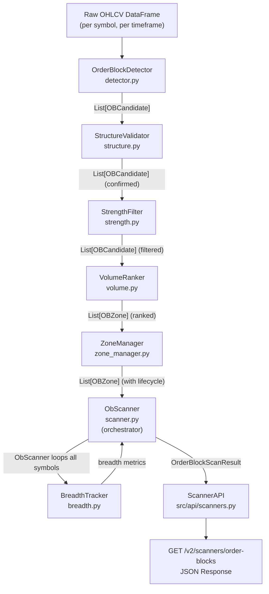
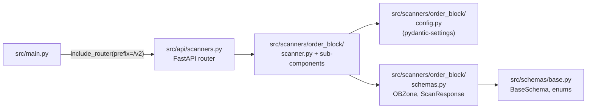
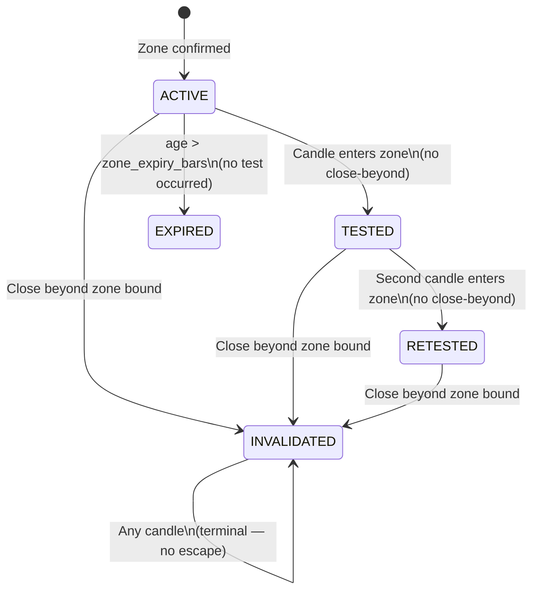

# Design Document: Order Block Scanner

## Overview

The Order Block Scanner is a new `src/scanners/` module that identifies institutional
order block zones across the F&O universe (~200+ NSE stocks), ranks them by volume and
liquidity, and exposes a REST endpoint at `GET /v2/scanners/order-blocks`.

An **order block** is the last opposing candle immediately before a strong impulsive move
that breaks market structure — a footprint of institutional accumulation or distribution.
Price frequently returns to these zones before continuing the prevailing trend, making
them high-value entry and re-entry targets.

**Design goals (in priority order)**:
1. **No look-ahead** — every feature value at bar `i` depends only on bars ≤ `i`.
2. **Composable pipeline** — each component (Detector → Validator → Filter → Ranker →
   Tracker → Manager → Scanner) is a pure function or stateless class that can be tested,
   replaced, or swapped independently.
3. **Property-verified correctness** — formal correctness properties derived from
   acceptance criteria are enforced via Hypothesis property-based tests.
4. **Consistent code style** — follows existing patterns in `src/features/`,
   `src/schemas/`, and `src/api/`.

---

## Architecture

### Component Pipeline



### Module Integration



**Router registration** in `src/main.py` (one new import line, after existing routers):

```python
from src.api import scanners as scanners_api
app.include_router(scanners_api.router, prefix="/v2")
```

Authentication is **not duplicated** — the global `api_key_middleware` in `main.py`
already enforces `X-API-KEY` on all non-exempt paths, so `ScannerAPI` requires no
additional auth logic.

---

## Module Structure

```
src/
  scanners/
    __init__.py
    order_block/
      __init__.py
      config.py         # OrderBlockConfig (pydantic-settings BaseSettings)
      schemas.py        # OBCandidate, OBZone, ScanResult, ScanResponse Pydantic models
      detector.py       # OrderBlockDetector — candidate detection
      structure.py      # StructureValidator — BoS confirmation
      strength.py       # StrengthFilter — ATR50 move ratio filter
      volume.py         # VolumeRanker — relative volume scoring and sort
      breadth.py        # BreadthTracker — F&O breadth metrics and regime
      zone_manager.py   # ZoneManager — zone lifecycle state machine
      scanner.py        # ObScanner — top-level orchestrator

src/
  api/
    scanners.py         # FastAPI router for GET /v2/scanners/order-blocks

tests/
  test_order_block_scanner.py   # All unit, PBT, TDD, PIT tests
```

---

## Components and Interfaces

### `config.py` — OrderBlockConfig

```python
from __future__ import annotations
from pydantic import Field
from pydantic_settings import BaseSettings, SettingsConfigDict

class OrderBlockConfig(BaseSettings):
    """
    All scanner parameters.  Reads from env vars (OB_* prefix) or .env file.
    Passed as a single config object to every sub-component so tests can
    override any parameter without monkey-patching globals.
    """
    model_config = SettingsConfigDict(env_prefix="OB_", extra="ignore")

    # Detection
    atr_window: int = Field(default=14, description="ATR rolling window for impulse detection")
    impulse_multiplier: float = Field(default=1.5, description="Body must exceed N×ATR to qualify as impulse")
    lookback_bars: int = Field(default=5, description="Max bars to look back from impulse for opposing candle")

    # Structure validation
    swing_lookback: int = Field(default=10, description="Trailing window for swing high/low")
    max_confirmation_bars: int = Field(default=20, description="BoS must be confirmed within N bars")
    # Per-timeframe overrides (applied by ObScanner)
    tf_5m_confirmation_bars: int = Field(default=30)
    tf_1d_confirmation_bars: int = Field(default=10)

    # Strength filter
    strength_multiplier: float = Field(default=1.5, description="move_ratio >= this to pass filter")
    atr_strength_window: int = Field(default=50, description="ATR window for strength baseline")

    # Volume ranking
    avg_volume_window: int = Field(default=20, description="Rolling window for average volume")

    # Zone lifecycle
    zone_expiry_bars: int = Field(default=200, description="ACTIVE zones expire after N bars without test")

    # Multi-TF confluence
    confluence_price_pct: float = Field(default=0.02, description="2% proximity threshold for confluence")

    # API defaults
    default_limit: int = Field(default=50)
    max_limit: int = Field(default=200)
```

---

### `schemas.py` — Data Models

All models inherit from `BaseSchema` (`strict=True, frozen=True`) following the pattern
in `src/schemas/base.py`.

```python
from __future__ import annotations
from enum import Enum
from datetime import datetime
from pydantic import Field
from src.schemas.base import BaseSchema

# ── Enums ──────────────────────────────────────────────────────────────────────

class OBZoneDirection(str, Enum):
    BULLISH = "bullish"
    BEARISH = "bearish"

class OBZoneLifecycle(str, Enum):
    ACTIVE      = "ACTIVE"
    TESTED      = "TESTED"
    RETESTED    = "RETESTED"
    INVALIDATED = "INVALIDATED"
    EXPIRED     = "EXPIRED"

class OBMarketRegime(str, Enum):
    BULLISH_SWEEP = "BULLISH_SWEEP"
    BEARISH_SWEEP = "BEARISH_SWEEP"
    MIXED         = "MIXED"

# ── Intermediate: candidate produced by Detector, confirmed by Validator ───────

class OBCandidate(BaseSchema):
    """
    Unconfirmed order block candidate — output of OrderBlockDetector.
    Becomes an OBZone after StructureValidator confirms a BoS.
    """
    symbol: str
    ob_bar_index: int           # Index i of the OB candle in the OHLCV series
    ob_timestamp: datetime
    direction: OBZoneDirection
    ob_high: float
    ob_low: float
    ob_open: float
    ob_close: float
    ob_volume: float
    impulse_bar_index: int      # Index j of the first impulse candle after i
    impulse_atr: float          # ATR14 value at bar j
    timeframe: str

class OBCandidateConfirmed(OBCandidate):
    """OBCandidate that passed StructureValidator — has BoS evidence."""
    bos_bar_index: int          # Index j where close crossed swing level
    bos_timestamp: datetime
    bos_level: float            # The swing_high or swing_low that was broken

# ── Primary domain object ──────────────────────────────────────────────────────

class OBZone(BaseSchema):
    """
    Fully confirmed, filtered, and ranked order block zone.
    Maps directly to the REST response fields in Req 8 AC5.
    """
    # Identity
    symbol: str
    direction: OBZoneDirection
    timeframe: str

    # Zone bounds
    ob_high: float
    ob_low: float
    ob_timestamp: datetime      # ISO-8601 UTC (serialised by Pydantic)

    # BoS evidence
    bos_timestamp: datetime

    # Scores
    volume_score: float         # ob_volume / avg_volume_20
    move_strength_ratio: float  # |close_j - open_j| / ATR50_j
    breadth_alignment_score: float

    # Lifecycle
    lifecycle_state: OBZoneLifecycle = OBZoneLifecycle.ACTIVE
    retest_count: int = 0
    invalidation_timestamp: datetime | None = None

    # Multi-TF
    multi_tf_confluence: bool = False

# ── Top-level scan response ───────────────────────────────────────────────────

class OrderBlockScanResponse(BaseSchema):
    """
    Full API response for GET /v2/scanners/order-blocks.
    Maps to Req 8 AC5 + AC6.
    """
    # Top-level (Req 8 AC6)
    scanned_at: datetime
    n_symbols_scanned: int
    market_regime: OBMarketRegime
    bullish_breadth: float      # in [0.0, 1.0]
    bearish_breadth: float      # in [0.0, 1.0]
    n_zones: int

    # Per-zone list (Req 8 AC5)
    zones: list[OBZone]
```

**Serialisation note**: `datetime` fields serialise to ISO-8601 UTC strings by default
in Pydantic V2 (`model_config = ConfigDict(json_encoders={datetime: ...})` not required).
`OBZoneDirection`, `OBZoneLifecycle`, `OBMarketRegime` serialise as their `.value`
strings because they inherit `(str, Enum)`.

---

### `detector.py` — OrderBlockDetector

**Responsibility**: Given a single-symbol OHLCV DataFrame, produce a list of
`OBCandidate` objects — one per qualifying order block candle.

**Algorithm** (pandas-vectorised with a single O(n) scan):

```python
def detect_candidates(
    df: pd.DataFrame,           # columns: open, high, low, close, volume; UTC DatetimeIndex
    symbol: str,
    timeframe: str,
    config: OrderBlockConfig,
) -> list[OBCandidate]:
    """
    Returns a list of OBCandidate for every qualifying OB candle in df.

    Steps
    -----
    1. Guard: return [] if len(df) < 15 or df has no non-NaN rows.
    2. Compute ATR14 (trailing, no center=True, min_periods=1):
           tr  = max(high-low, |high-prev_close|, |low-prev_close|)
           atr = tr.rolling(window=atr_window, min_periods=1).mean()
    3. Compute body_size = abs(close - open).
    4. impulse_bull mask: body_size > impulse_multiplier * atr
                          AND close > open  (bullish impulse)
       impulse_bear mask: body_size > impulse_multiplier * atr
                          AND close < open  (bearish impulse)
    5. For each impulse bar j (iterate forward):
       a. Search back from j-1 to max(0, j-lookback_bars) for the LAST
          opposing candle:
          - Bullish impulse → last bar i where close[i] < open[i]  (bearish candle)
          - Bearish impulse → last bar i where close[i] > open[i]  (bullish candle)
       b. If found, emit OBCandidate(ob_bar_index=i, impulse_bar_index=j, ...).
       c. Skip if any of open/high/low/close/volume at i or j is NaN.
    6. Deduplicate: if the same OB candle i is referenced by multiple impulse bars,
       keep only the entry with the largest impulse body size (highest conviction).
    """
```

**Key implementation constraints** (enforce no-lookahead):
- `atr.rolling(window=N, min_periods=1)` — never `center=True`
- The backward search in step 5a starts at `j-1` and walks toward `j-lookback_bars`;
  the **last** (most recent) opposing candle found is selected, not the first.
- No future bar data is accessed at any point.

---

### `structure.py` — StructureValidator

**Responsibility**: For each `OBCandidate`, search forward for a BoS-confirming candle
within `max_confirmation_bars`. Returns confirmed candidates as `OBCandidateConfirmed`.

```python
def validate_structure(
    candidates: list[OBCandidate],
    df: pd.DataFrame,
    config: OrderBlockConfig,
) -> list[OBCandidateConfirmed]:
    """
    Algorithm per candidate at OB bar index i
    ------------------------------------------
    1. Compute trailing swing_high and swing_low:
           swing_window = config.swing_lookback * 2 + 1
           swing_high = df['high'].rolling(window=swing_window, min_periods=config.swing_lookback+1).max()
           swing_low  = df['low'].rolling(window=swing_window, min_periods=config.swing_lookback+1).min()
       These are computed once for the whole df, NOT recomputed per candidate.

    2. Reference level at bar i (the level the market was "watching"):
           ref_high = swing_high.shift(config.swing_lookback).iloc[i]
           ref_low  = swing_low.shift(config.swing_lookback).iloc[i]

    3. Confirmation window: bars [i+1, i + max_confirmation_bars].

    4. For bullish candidate:
       Scan j from i+1 to i+max_confirmation_bars inclusive:
         if df['close'].iloc[j] > ref_high:   → CONFIRMED at j
       If no j found: mark as EXPIRED (excluded from results).

    5. For bearish candidate:
       Same scan but check df['close'].iloc[j] < ref_low.

    6. Wicks: df['high'].iloc[j] > ref_high but df['close'].iloc[j] <= ref_high → NOT confirmed.

    7. On confirmation, record bos_bar_index=j, bos_level=ref_high (or ref_low),
       bos_timestamp=df.index[j].
    """
```

**Why `.shift(lookback)`**: Per requirement 9.4, the reference level must be the swing
computed `lookback` bars *before* the current bar — reflecting the structural reference
that was visible to a trader at the time. Without the shift, the reference would include
the OB bar itself, introducing subtle look-ahead.

---

### `strength.py` — StrengthFilter

**Responsibility**: Filter `OBCandidateConfirmed` list to only those where the confirming
impulse candle has `move_strength_ratio >= config.strength_multiplier`.

```python
def filter_by_strength(
    candidates: list[OBCandidateConfirmed],
    df: pd.DataFrame,
    config: OrderBlockConfig,
    logger: BoundLogger,
) -> list[OBCandidateConfirmed]:
    """
    Per confirmed candidate:
    1. Compute ATR50 at bar j (impulse_bar_index):
           atr50 = df['close'].copy()  # use true-range series
           tr    = compute_tr(df)
           atr50 = tr.rolling(window=config.atr_strength_window, min_periods=1).mean()
    2. move_strength_ratio = abs(df['close'].iloc[j] - df['open'].iloc[j]) / atr50.iloc[j]
    3. If ratio >= config.strength_multiplier: include in output.
       Else: log at DEBUG (symbol, bar_index, computed ratio); exclude.
    """
```

**Cross-symbol isolation**: `filter_by_strength` accepts a single-symbol `df`. The
`ObScanner` calls it once per symbol in isolation — no cross-symbol ATR comparison can
occur by construction (addresses Req 4.5).

---

### `volume.py` — VolumeRanker

**Responsibility**: Compute `volume_score` for each zone, then sort descending.

```python
def rank_by_volume(
    zones: list[OBZone],
    df_by_symbol: dict[str, pd.DataFrame],
    config: OrderBlockConfig,
) -> list[OBZone]:
    """
    For each zone z:
    1. df = df_by_symbol[z.symbol]
    2. avg_vol_20 = df['volume'].rolling(config.avg_volume_window, min_periods=1).mean()
                              .loc[z.ob_timestamp]
    3. If avg_vol_20 == 0.0 or NaN: volume_score = 0.0
       Else: volume_score = z.ob_volume / avg_vol_20

    4. Rebuild OBZone with updated volume_score (frozen Pydantic model →
       use .model_copy(update={'volume_score': score})).

    5. Sort: zones.sort(key=lambda z: (-z.volume_score, z.ob_timestamp), reverse=False)
       Primary: descending volume_score
       Tie-break: descending ob_timestamp (most recent zone first)

    6. Return sorted list.  All other fields unchanged.
    """
```

**Metadata preservation**: Because `OBZone` is `frozen=True`, the ranker never mutates
fields in place — it uses `.model_copy()` and returns a new list. This guarantees
metadata is preserved (Req 3.5).

---

### `breadth.py` — BreadthTracker

**Responsibility**: Aggregate per-symbol zone lists into breadth metrics and regime.

```python
def compute_breadth(
    zones_by_symbol: dict[str, list[OBZone]],
    total_symbols: int,
) -> BreadthResult:
    """
    breadth_threshold = 0.6

    bull_symbols = count of symbols where any zone has
                   direction == BULLISH and lifecycle_state == ACTIVE
    bear_symbols = count of symbols where any zone has
                   direction == BEARISH and lifecycle_state == ACTIVE

    bullish_breadth = bull_symbols / total_symbols   (0.0 if total_symbols == 0)
    bearish_breadth = bear_symbols / total_symbols

    market_regime:
      if bullish_breadth > breadth_threshold: BULLISH_SWEEP
      elif bearish_breadth > breadth_threshold: BEARISH_SWEEP
      else: MIXED

    For each zone, breadth_alignment_score:
      BULLISH zone → bullish_breadth
      BEARISH zone → bearish_breadth
    """
```

Edge case (Req 5.7): when `total_symbols == 0` (empty F&O universe), use
`bullish_breadth = bearish_breadth = 0.0`, `market_regime = MIXED`, no exception.

---

### `zone_manager.py` — ZoneManager

**Responsibility**: Apply lifecycle state transitions to a list of `OBZone` objects
given a new candle.

```python
def update_zone_lifecycle(
    zone: OBZone,
    candle_low: float,
    candle_high: float,
    candle_close: float,
    candle_bar_index: int,
    creation_bar_index: int,
    config: OrderBlockConfig,
) -> OBZone:
    """
    State machine transitions (Req 6):

    TERMINAL STATE: INVALIDATED — return immediately, no further processing.

    INVALIDATION CHECK (highest priority, any state):
      Bullish zone: if candle_close < zone.ob_low  → INVALIDATED
      Bearish zone: if candle_close > zone.ob_high → INVALIDATED

    EXPIRY CHECK (only ACTIVE zones):
      if lifecycle_state == ACTIVE and
         (candle_bar_index - creation_bar_index) > config.zone_expiry_bars:
         → EXPIRED

    TEST TRANSITIONS (entry without close beyond zone):
      Bullish zone, ACTIVE:
        if candle_low <= zone.ob_high and candle_low >= zone.ob_low and
           candle_close >= zone.ob_low:  → TESTED (retest_count = 1)
      Bullish zone, TESTED:
        same entry condition:  → RETESTED (retest_count += 1)

    (Symmetric for bearish zones)

    Returns new OBZone with updated fields via .model_copy().
    """
```

**State machine diagram**:



---

### `scanner.py` — ObScanner

**Responsibility**: Orchestrate the full pipeline across the F&O universe for all
configured timeframes.

```python
class ObScanner:
    def __init__(self, config: OrderBlockConfig | None = None) -> None:
        self.config = config or OrderBlockConfig()

    def scan(
        self,
        ohlcv_by_symbol: dict[str, pd.DataFrame],
        timeframe: str,
        existing_zones: dict[str, list[OBZone]] | None = None,
    ) -> OrderBlockScanResult:
        """
        1. Validate timeframe → raise ValueError if unsupported.
        2. Apply per-timeframe config overrides (swing_lookback, max_confirmation_bars).
        3. For each symbol in ohlcv_by_symbol (independent, parallelisable):
           a. detect_candidates(df, symbol, timeframe, config)
           b. validate_structure(candidates, df, config)
           c. filter_by_strength(confirmed, df, config, logger)
           d. If existing_zones[symbol] exists, run update_zone_lifecycle for each
              existing zone against the latest candle.
           e. Convert confirmed candidates to new OBZone objects (lifecycle=ACTIVE).
           f. Merge new zones + existing (non-INVALIDATED unless requested) zones.
        4. rank_by_volume(all_zones, ohlcv_by_symbol, config)
        5. compute_multi_tf_confluence(zones, config)  — flag pairs within 2% price proximity
        6. zones_by_symbol = group ranked zones by symbol
        7. compute_breadth(zones_by_symbol, len(ohlcv_by_symbol))
        8. Assign breadth_alignment_score to each zone.
        9. Return OrderBlockScanResult(zones, breadth_result, scanned_at=now_utc).
        """
```

**Multi-timeframe confluence** (Req 7.6): After ranking, for each pair of bullish zones
on `1h` and `1d` timeframes for the same symbol, compute price proximity as
`abs(z1.ob_high - z2.ob_high) / z1.ob_high`. If `< config.confluence_price_pct (0.02)`,
set `multi_tf_confluence = True` on both via `.model_copy()`.

**Supported timeframes**: `"5m"`, `"15m"`, `"1h"`, `"1d"`. Any other value raises
`ValueError("Unsupported timeframe '{tf}'. Valid values: 5m, 15m, 1h, 1d")`.

---

### `src/api/scanners.py` — ScannerAPI

```python
from __future__ import annotations

from datetime import datetime, timezone

from fastapi import APIRouter, Query
from fastapi.responses import JSONResponse

from src.scanners.order_block.config import OrderBlockConfig
from src.scanners.order_block.schemas import OBZoneDirection, OBZoneLifecycle, OrderBlockScanResponse
from src.scanners.order_block.scanner import ObScanner

router = APIRouter(tags=["scanners"])

_config = OrderBlockConfig()
_scanner = ObScanner(config=_config)

VALID_TIMEFRAMES = frozenset({"5m", "15m", "1h", "1d"})

@router.get("/scanners/order-blocks")
async def get_order_blocks(
    limit: int = Query(default=50, ge=1, le=200),
    direction: str | None = Query(default=None),
    timeframe: str | None = Query(default=None),
    include_invalidated: bool = Query(default=False),
) -> JSONResponse:
    """
    Returns ranked confirmed order block zones across the F&O universe.

    Auth: X-API-KEY header (enforced globally by api_key_middleware in main.py)
    422 returned automatically by FastAPI when limit < 1 or > 200 (via ge/le).
    """
    # Validate direction
    if direction is not None and direction not in ("bullish", "bearish"):
        return JSONResponse(
            status_code=422,
            content={"detail": f"direction must be 'bullish' or 'bearish', got '{direction}'"},
        )
    # Validate timeframe
    if timeframe is not None and timeframe not in VALID_TIMEFRAMES:
        return JSONResponse(
            status_code=422,
            content={"detail": f"timeframe must be one of {sorted(VALID_TIMEFRAMES)}, got '{timeframe}'"},
        )

    # --- Fetch OHLCV data (injected from data service / cache) ---
    # NOTE: Implementation should call the market data client here.
    # Shown as placeholder; actual data sourcing depends on deployment context.
    ohlcv_by_symbol = _fetch_ohlcv(timeframe or "1h")

    result = _scanner.scan(ohlcv_by_symbol, timeframe=timeframe or "1h")

    zones = result.zones
    if not include_invalidated:
        zones = [z for z in zones if z.lifecycle_state != OBZoneLifecycle.INVALIDATED]
    if direction:
        zones = [z for z in zones if z.direction.value == direction]
    if timeframe:
        zones = [z for z in zones if z.timeframe == timeframe]
    zones = zones[:limit]

    response = OrderBlockScanResponse(
        scanned_at=result.scanned_at,
        n_symbols_scanned=result.n_symbols_scanned,
        market_regime=result.breadth.market_regime,
        bullish_breadth=result.breadth.bullish_breadth,
        bearish_breadth=result.breadth.bearish_breadth,
        n_zones=len(zones),
        zones=zones,
    )
    return JSONResponse(content=response.model_dump(mode="json"))
```

**HTTP 200 on empty zones** (Req 8.7): the empty `zones=[]` case is handled naturally —
`OrderBlockScanResponse` serialises with `n_zones=0, zones=[]` and returns 200.

**HTTP 401** (Req 8.8): handled globally by `api_key_middleware` in `main.py` — no
additional auth code needed in the router.

---

## Data Models

### Inheritance Hierarchy

```
pydantic.BaseModel
  └── BaseSchema (strict=True, frozen=True)
        ├── OBCandidate
        │     └── OBCandidateConfirmed
        ├── OBZone
        ├── OrderBlockScanResponse
        └── BreadthResult
```

### OBZone Field Reference

| Field | Type | Description | Source |
|---|---|---|---|
| `symbol` | `str` | NSE ticker symbol | OHLCV input |
| `direction` | `OBZoneDirection` | `"bullish"` or `"bearish"` | Detector |
| `timeframe` | `str` | `"5m"`, `"15m"`, `"1h"`, `"1d"` | ObScanner |
| `ob_high` | `float` | High of the OB candle | OHLCV at index i |
| `ob_low` | `float` | Low of the OB candle | OHLCV at index i |
| `ob_timestamp` | `datetime` | UTC timestamp of OB candle | OHLCV index at i |
| `bos_timestamp` | `datetime` | UTC timestamp of BoS confirmation | OHLCV index at j |
| `volume_score` | `float` | `ob_volume / avg_volume_20` | VolumeRanker |
| `move_strength_ratio` | `float` | `\|close_j - open_j\| / ATR50_j` | StrengthFilter |
| `breadth_alignment_score` | `float` | Breadth fraction for zone direction | BreadthTracker |
| `lifecycle_state` | `OBZoneLifecycle` | Current zone state | ZoneManager |
| `multi_tf_confluence` | `bool` | True if aligned on 2+ timeframes | ObScanner |

---

## Correctness Properties

*A property is a characteristic or behavior that should hold true across all valid
executions of a system — essentially, a formal statement about what the system should do.
Properties serve as the bridge between human-readable specifications and
machine-verifiable correctness guarantees.*

---

### Property 1: OB Candidate Detection Definition

*For any* valid OHLCV_Series and any detected bullish `OBCandidate` at index `i`, the
candle at `i` must be bearish (`close[i] < open[i]`) and there must exist an impulse bar
`j > i` where `close[j] > open[j]` and `abs(close[j] - open[j]) > 1.5 × ATR14[j]`.
(Symmetric: any detected bearish candidate at `i` must have `close[i] > open[i]` and a
bearish impulse bar `j`.)

**Validates: Requirements 1.1, 1.2**

---

### Property 2: Last Opposing Candle Selection

*For any* OHLCV_Series containing `k ≥ 2` consecutive opposing candles before an impulse
bar `j`, the detected OB index must equal the index of the most recent (last) opposing
candle — not any earlier one in the run.

**Validates: Requirements 1.6, 1.7**

---

### Property 3: BoS Confirmation Invariant

*For any* confirmed `OBZone` at bar `i`, there must exist at least one bar `j > i` where
`close[j]` strictly exceeds the Swing_High computed over the trailing window ending at
bar `i` (for bullish zones), or `close[j]` strictly falls below the Swing_Low (for
bearish zones). Equivalently: the confirming close value must lie on the correct side of
the swing reference level.

**Validates: Requirements 2.1, 2.2, 10.1**

---

### Property 4: No-Lookahead Invariant

*For any* OHLCV_Series of length `n`, appending any arbitrary candle at index `n` must
not change the set of `OBZone` records previously detected in bars `[0, n-1]`. The zone
set is compared by `(symbol, ob_timestamp, direction)` identity.

**Validates: Requirements 1.3, 2.4, 9.1, 9.2, 9.3, 9.4, 10.4**

---

### Property 5: Volume Monotonicity and Metadata Preservation

*For any* list of `OBZone` objects, after `VolumeRanker` sorts them, `volume_score[k] ≥
volume_score[k+1]` for all valid `k`. Additionally, all field values (`symbol`,
`direction`, `ob_high`, `ob_low`, `ob_timestamp`, `bos_timestamp`, `lifecycle_state`,
`timeframe`) must be identical to the corresponding values in the input list — sorting
must not mutate zone data.

**Validates: Requirements 3.2, 3.3, 3.5, 10.3**

---

### Property 6: Strength Filter Correctness

*For any* set of OB candidates with computed `move_strength_ratio` values, every zone
that passes `StrengthFilter` satisfies `move_strength_ratio ≥ config.strength_multiplier`,
and no zone with `move_strength_ratio < config.strength_multiplier` appears in the
filtered output.

**Validates: Requirements 4.1, 4.2**

---

### Property 7: Breadth Bounds and Alignment

*For any* set of scanned symbols, `bullish_breadth ∈ [0.0, 1.0]` and `bearish_breadth ∈
[0.0, 1.0]`. Furthermore, for every bullish `OBZone` in the result, its
`breadth_alignment_score` equals `bullish_breadth`, and for every bearish zone, it equals
`bearish_breadth`.

**Validates: Requirements 5.1, 5.2, 5.3**

---

### Property 8: Zone Terminal Invalidation

*For any* `OBZone` in any lifecycle state (`ACTIVE`, `TESTED`, or `RETESTED`), once a
candle triggers invalidation (close below `ob_low` for bullish, close above `ob_high` for
bearish), the zone transitions to `INVALIDATED`. Subsequently, *for any* sequence of
candles applied to an `INVALIDATED` zone, its `lifecycle_state` remains `INVALIDATED`
(terminal state — no escape).

**Validates: Requirements 6.4, 6.5, 6.6**

---

### Property 9: OBZone Round-Trip Serialization

*For any* `OBZone` object `z`, `OBZone.model_validate(z.model_dump(mode="json"))` must
produce a value equal to `z` under Pydantic's equality semantics (all field values
identical, including nested enums and datetimes).

**Validates: Requirements 10.2**

---

### Property 10: Timeframe Tagging Consistency

*For any* single-timeframe scan invocation with parameter `tf ∈ {"5m", "15m", "1h", "1d"}`,
every `OBZone` in the result must have `zone.timeframe == tf`. Zones from different
timeframes must not appear in a single-timeframe result.

**Validates: Requirements 7.5**

---

### Property 11: API Response Schema Completeness

*For any* non-empty list of `OBZone` objects processed by the scanner, each zone's JSON
representation in the API response must contain all 12 required fields: `symbol`,
`direction`, `timeframe`, `ob_high`, `ob_low`, `ob_timestamp`, `bos_timestamp`,
`volume_score`, `move_strength_ratio`, `breadth_alignment_score`, `lifecycle_state`,
`multi_tf_confluence`.

**Validates: Requirements 8.5**

---

## Error Handling

| Scenario | Component | Behaviour |
|---|---|---|
| `len(df) < 15` | OrderBlockDetector | Return `[]`, no exception |
| NaN in OHLCV columns | OrderBlockDetector | Skip affected bars, continue |
| No BoS within `max_confirmation_bars` | StructureValidator | Mark candidate EXPIRED, exclude from OBZones |
| `avg_volume_20 == 0` | VolumeRanker | Set `volume_score = 0.0`, place zone last |
| `len(ohlcv_by_symbol) == 0` | BreadthTracker | Return `bullish_breadth=0.0`, `bearish_breadth=0.0`, regime=MIXED |
| Unsupported `timeframe` value | ObScanner | Raise `ValueError` listing valid values |
| Missing/invalid `X-API-KEY` | `api_key_middleware` | HTTP 401, no zone payload |
| `limit < 1 or > 200` | FastAPI Query validation (`ge=1, le=200`) | HTTP 422 automatically |
| Invalid `direction` value | ScannerAPI | HTTP 422 with descriptive message |
| Unhandled exception in scan | `global_exception_handler` (main.py) | HTTP 500, error logged |

**Logging** (structlog, matching project conventions):
- `DEBUG`: every zone excluded by StrengthFilter (symbol, bar index, computed ratio)
- `INFO`: scan completion (symbols scanned, zones found, regime, elapsed ms)
- `WARNING`: OHLCV data quality issues (NaN fraction > 5%)
- `ERROR`: any exception escaping a per-symbol scan (symbol isolated, scan continues)

---

## Testing Strategy

### Test File Layout

```
tests/test_order_block_scanner.py
  # ── Hypothesis strategies ────────────────────────────────────────
  ohlcv_series_strategy()          # generates realistic OHLCV DataFrames
  ob_zone_strategy()               # generates random OBZone objects
  candle_strategy()                # generates single OHLCV row as Series

  # ── Property-based tests (Property 1–11 above) ─────────────────
  test_candidate_detection_definition()          # Property 1
  test_last_opposing_candle_selection()          # Property 2
  test_bos_confirmation_invariant()              # Property 3
  test_no_lookahead_invariant()                  # Property 4
  test_volume_monotonicity_and_metadata()        # Property 5
  test_strength_filter_correctness()             # Property 6
  test_breadth_bounds_and_alignment()            # Property 7
  test_zone_terminal_invalidation()              # Property 8
  test_ob_zone_round_trip_serialization()        # Property 9
  test_timeframe_tagging_consistency()           # Property 10
  test_api_response_schema_completeness()        # Property 11

  # ── TDD red-phase tests (@pytest.mark.tdd) ─────────────────────
  # One test per acceptance criterion, Requirements 1–9
  # These MUST fail before implementation exists.

  # ── Example-based unit tests (@pytest.mark.unit) ────────────────
  test_fewer_than_15_bars_returns_empty()        # Req 1.4
  test_nan_bars_skipped()                        # Req 1.5
  test_wick_only_not_confirmed()                 # Req 2.3
  test_bos_confirmation_records_evidence()       # Req 2.5
  test_candidate_expires_after_max_bars()        # Req 2.6
  test_zero_avg_volume_score_is_zero()           # Req 3.4
  test_filtered_zone_logged_at_debug()           # Req 4.3
  test_short_series_atr_min_periods()            # Req 4.4
  test_breadth_regime_thresholds()               # Req 5.4-5.6
  test_empty_universe_breadth()                  # Req 5.7
  test_new_zone_is_active()                      # Req 6.1
  test_zone_tested_transition()                  # Req 6.2
  test_zone_retested_transition()                # Req 6.3
  test_invalidated_excluded_by_default()         # Req 6.7
  test_active_zone_expires_after_timeout()       # Req 6.8
  test_valid_timeframes_accepted()               # Req 7.1-7.3
  test_invalid_timeframe_raises()                # Req 7.4
  test_multitf_confluence_flag()                 # Req 7.6

  # ── API integration tests (FastAPI TestClient) ──────────────────
  test_endpoint_exists_returns_200()             # Req 8.1
  test_limit_parameter()                         # Req 8.2
  test_direction_filter()                        # Req 8.3
  test_timeframe_filter()                        # Req 8.4
  test_top_level_response_fields()               # Req 8.6
  test_empty_zones_returns_200()                 # Req 8.7
  test_missing_api_key_returns_401()             # Req 8.8
  test_limit_out_of_range_returns_422()          # Req 8.9

  # ── PIT tests (@pytest.mark.pit) ────────────────────────────────
  test_no_zone_uses_future_timestamp()           # Req 10.6
```

### Hypothesis Strategies

```python
from hypothesis import given, settings as hyp_settings
from hypothesis import strategies as st
import pandas as pd
import numpy as np

# Price strategy — realistic, non-degenerate (Req 10.7)
price_st = st.floats(min_value=1.0, max_value=100_000.0,
                     allow_nan=False, allow_infinity=False)
volume_st = st.floats(min_value=0.0, max_value=1e10,
                      allow_nan=False, allow_infinity=False)

@st.composite
def ohlcv_series_strategy(draw, min_bars: int = 20, max_bars: int = 200) -> pd.DataFrame:
    """
    Generate a valid OHLCV DataFrame with DatetimeIndex.
    Ensures: high >= max(open, close) >= min(open, close) >= low > 0
    """
    n = draw(st.integers(min_value=min_bars, max_value=max_bars))
    closes = draw(st.lists(price_st, min_size=n, max_size=n))
    # ... construct OHLCV ensuring OHLC validity ...

@st.composite
def ob_zone_strategy(draw) -> OBZone:
    """Generate a random valid OBZone for schema/sort/serialisation tests."""
    ob_low  = draw(price_st)
    ob_high = draw(st.floats(min_value=ob_low, max_value=ob_low * 1.5,
                             allow_nan=False, allow_infinity=False))
    # ... fill all required fields ...
```

### Property Test Configuration

```python
# All property tests: minimum 100 examples (Req 10.8)
@hyp_settings(max_examples=100)
@given(ohlcv_series_strategy())
@pytest.mark.unit
@pytest.mark.slow          # mark tests with > 50 examples (Req 10.8)
def test_no_lookahead_invariant(ohlcv: pd.DataFrame) -> None:
    """
    Feature: order-block-scanner, Property 4: No-Lookahead Invariant
    """
    scanner = ObScanner()
    zones_before = scanner.scan({"SYM": ohlcv}, timeframe="1h").zones
    extra_candle  = _generate_candle(ohlcv)
    extended_df   = pd.concat([ohlcv, extra_candle])
    zones_after   = scanner.scan({"SYM": extended_df}, timeframe="1h").zones
    # OBZones detected in [0, n-1] must be identical
    before_keys = {(z.ob_timestamp, z.direction) for z in zones_before}
    after_keys  = {(z.ob_timestamp, z.direction) for z in zones_after
                   if z.ob_timestamp < extra_candle.index[0]}
    assert before_keys == after_keys
```

Each property test includes a comment with the tag format:
`# Feature: order-block-scanner, Property N: <property_text>` (Req 10.8).

### Dual Testing Philosophy

Unit tests catch specific concrete bugs (e.g., "the 14th bar returns empty, not an
exception"). Property tests verify universal invariants (e.g., "no matter what OHLCV
data you generate, appending a bar never changes prior detections"). Both are necessary;
neither alone is sufficient.

Avoid writing redundant unit tests for behaviors already covered by properties —
property tests run 100+ generated examples and are more thorough for general logic.
Reserve unit tests for edge cases (NaN, zero-length, boundary thresholds) and
integration tests for API behavior.

### Property-Based Testing Library

**Library**: `hypothesis==6.123.4` (already in `pyproject.toml` dev dependencies).

**CI**: Run with `--hypothesis-seed=0` for reproducible failures (Req 10.8). Tests
marked `@pytest.mark.slow` may be excluded from fast CI runs via `-m "not slow"`.

---

## Integration Points

### `src/main.py` — Router Registration

Add one import line and one `include_router` call after the existing routers:

```python
# In the "Router registration" section of src/main.py:
from src.api import scanners as scanners_api          # new
app.include_router(scanners_api.router, prefix="/v2") # new
```

This exposes `GET /v2/scanners/order-blocks`. No other changes to `main.py` are needed.

### Authentication

The existing `api_key_middleware` in `main.py` enforces `X-API-KEY` on all paths not in
`_EXEMPT_PATHS`. Since `/v2/scanners/order-blocks` is not exempt, it is automatically
protected. The scanner router adds no auth logic of its own — consistent with all other
`src/api/` routers (Req 8.8).

### Configuration

`OrderBlockConfig` uses `pydantic-settings` with `env_prefix="OB_"`. All parameters have
sensible defaults and are overridable via environment variables:

```
OB_ATR_WINDOW=14
OB_IMPULSE_MULTIPLIER=1.5
OB_SWING_LOOKBACK=10
OB_MAX_CONFIRMATION_BARS=20
OB_STRENGTH_MULTIPLIER=1.5
OB_AVG_VOLUME_WINDOW=20
OB_ZONE_EXPIRY_BARS=200
OB_DEFAULT_LIMIT=50
```

### Market Data

The `ObScanner.scan()` method accepts `ohlcv_by_symbol: dict[str, pd.DataFrame]` — a
plain dict of DataFrames injected by the caller. The `ScannerAPI` router is responsible
for fetching this data from the market data client (or Redis cache). This decouples the
scanner's pure detection logic from I/O concerns, making all components testable with
synthetic in-memory DataFrames.

### `src/scanners/__init__.py`

```python
"""Order Block Scanner module — institutional zone detection for the F&O universe."""
```

This makes `src/scanners` a proper Python package importable alongside `src/features`,
`src/api`, etc.
