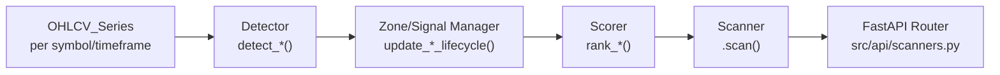
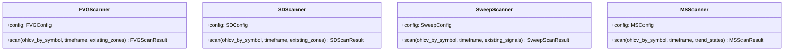
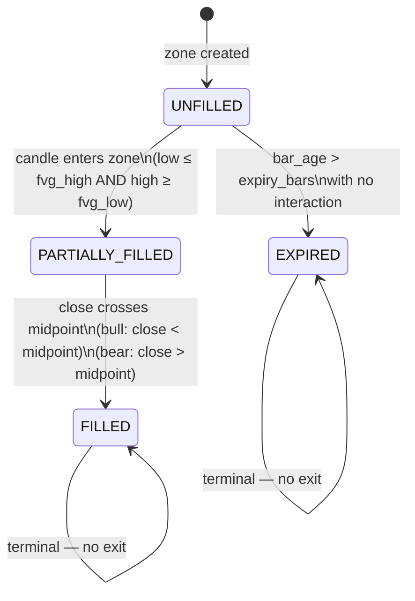
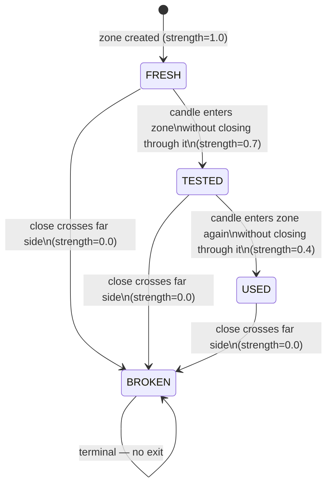
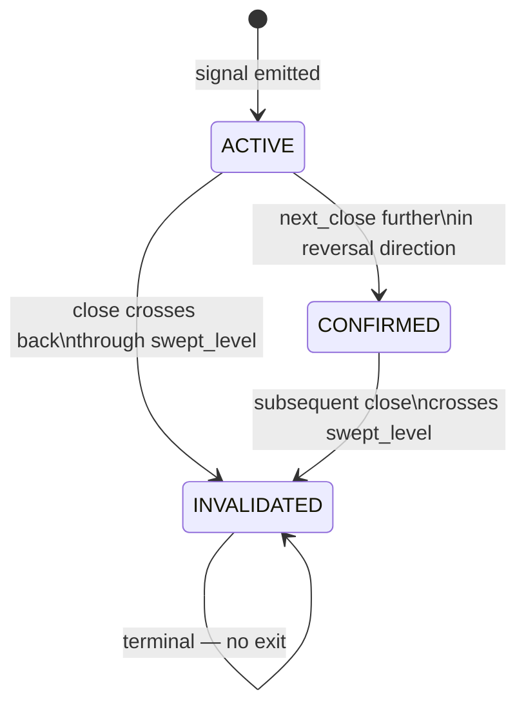

# Design Document — Smart Money Scanners

## Overview

This document specifies the technical design for four new Smart Money Concept (SMC)
scanner modules added to `src/scanners/`:

| Module | Endpoint | Signal |
|---|---|---|
| `fair_value_gap` | `GET /v2/scanners/fair-value-gaps` | 3-candle imbalance zones |
| `supply_demand` | `GET /v2/scanners/supply-demand` | Consolidation-departure zones |
| `liquidity_sweep` | `GET /v2/scanners/liquidity-sweeps` | Stop-hunt reversal events |
| `market_structure` | `GET /v2/scanners/market-structure` | BoS / ChoCh structural signals |

Every module mirrors the `src/scanners/order_block/` blueprint — identical file layout,
identical base classes, identical conventions. The existing `src/api/scanners.py` router
is **extended** (not replaced) with four new route functions.

---

## Architecture

### Pipeline Topology

All four scanners follow the same linear pipeline:



Each stage is a pure function or stateless class:
- **Detector** — reads OHLCV, emits raw signal objects (no state)
- **Zone/Signal Manager** — advances lifecycle on a single object; immutable via
  `.model_copy(update={…})`
- **Scorer** — computes scores and sorts a list; no side effects
- **Scanner** — orchestrates the pipeline for all symbols; holds a config instance

### Scanner Class Architecture



### Module Layout

```
src/scanners/
  fair_value_gap/
    __init__.py
    config.py          # FVGConfig  (BaseSettings, env_prefix="FVG_")
    schemas.py         # FVGDirection, FVGLifecycle, FVGZone, FVGScanResult, FVGScanResponse
    detector.py        # detect_fvg_zones(df, symbol, timeframe, config) → list[FVGZone]
    zone_manager.py    # update_fvg_lifecycle(zone, candle_low, high, close, bar_idx, config) → FVGZone
    scorer.py          # rank_fvg_zones(zones, df_by_symbol, config) → list[FVGZone]
    scanner.py         # FVGScanner.scan()
  supply_demand/
    __init__.py
    config.py          # SDConfig   (BaseSettings, env_prefix="SD_")
    schemas.py         # SDDirection, SDZoneType, SDLifecycle, SDZone, SDScanResult, SDScanResponse
    detector.py        # detect_sd_zones(df, symbol, timeframe, config) → list[SDZone]
    zone_manager.py    # update_sd_lifecycle(zone, candle_low, high, close, bar_idx, config) → SDZone
    scorer.py          # rank_sd_zones(zones, df_by_symbol, config) → list[SDZone]
    scanner.py         # SDScanner.scan()
  liquidity_sweep/
    __init__.py
    config.py          # SweepConfig (BaseSettings, env_prefix="SWEEP_")
    schemas.py         # SweepDirection, SweepLifecycle, SweepSignal, SweepScanResult, SweepScanResponse
    detector.py        # detect_sweeps(df, symbol, timeframe, config) → list[SweepSignal]
    signal_manager.py  # update_sweep_lifecycle(signal, next_candle_close, bar_idx, config) → SweepSignal
    scorer.py          # rank_sweeps(signals, config) → list[SweepSignal]
    scanner.py         # SweepScanner.scan()
  market_structure/
    __init__.py
    config.py          # MSConfig   (BaseSettings, env_prefix="MS_")
    schemas.py         # MSSignalType, TrendState, MSSignal, MSScanResult, MSScanResponse
    detector.py        # detect_market_structure(df, symbol, timeframe, config) → list[MSSignal]
    state_manager.py   # TrendStateTracker class
    scorer.py          # rank_ms_signals(signals, config) → list[MSSignal]
    scanner.py         # MSScanner.scan()
```

---

## Components and Interfaces

### 1. Fair Value Gap Scanner

#### `FVGConfig` (config.py)

```python
class FVGConfig(BaseSettings):
    model_config = SettingsConfigDict(env_prefix="FVG_", extra="ignore")

    # Detection
    atr_window: int = Field(default=14, description="ATR rolling window")
    impulse_atr_multiplier: float = Field(default=1.0, description="Min Candle_2 body as multiple of ATR14")
    min_gap_atr_multiplier: float = Field(default=0.5, description="Min gap size as multiple of ATR14 at Candle_3")

    # Lifecycle / expiry
    fvg_expiry_bars: int = Field(default=100, description="Default bars until UNFILLED zone expires")
    tf_5m_expiry_bars: int = Field(default=288, description="Expiry bars for 5m timeframe (~24 h)")
    tf_15m_expiry_bars: int = Field(default=96, description="Expiry bars for 15m timeframe (~24 h)")
    tf_1h_expiry_bars: int = Field(default=24, description="Expiry bars for 1h timeframe (~24 h)")
    tf_1d_expiry_bars: int = Field(default=20, description="Expiry bars for 1d timeframe (20 trading days)")

    # Multi-TF confluence
    confluence_price_pct: float = Field(default=0.01, description="1% proximity threshold for confluence")

    # API defaults
    default_limit: int = Field(default=50)
    max_limit: int = Field(default=200)
```

#### `FVGZone` schema (schemas.py)

```python
class FVGDirection(str, Enum):
    BULLISH = "bullish"
    BEARISH = "bearish"

class FVGLifecycle(str, Enum):
    UNFILLED       = "UNFILLED"
    PARTIALLY_FILLED = "PARTIALLY_FILLED"
    FILLED         = "FILLED"
    EXPIRED        = "EXPIRED"

class FVGZone(BaseSchema):
    symbol: str
    direction: FVGDirection
    timeframe: str
    fvg_high: float
    fvg_low: float
    fvg_midpoint: float
    fvg_timestamp: datetime              # timestamp of Candle_3 (point-in-time anchor)
    candle1_bar_index: int
    candle3_bar_index: int
    impulse_atr: float                   # ATR14 at Candle_2
    lifecycle_state: FVGLifecycle = FVGLifecycle.UNFILLED
    fill_timestamp: datetime | None = None
    gap_size_score: float = 0.0
    volume_score: float = 0.0
    combined_score: float = 0.0

class FVGScanResult(BaseSchema):
    zones: list[FVGZone]
    scanned_at: datetime
    n_symbols_scanned: int

class FVGScanResponse(BaseSchema):
    scanned_at: datetime
    n_symbols_scanned: int
    n_zones: int
    zones: list[FVGZone]
```

#### `detect_fvg_zones` algorithm (detector.py)

```
function detect_fvg_zones(df, symbol, timeframe, config):
  GUARD: if len(df) < 3: return []
  GUARD: if all OHLC NaN: return []

  prev_close = close.shift(1)
  tr = max(high-low, |high-prev_close|, |low-prev_close|) column-wise
  atr = tr.rolling(window=config.atr_window, min_periods=1).mean()
  avg_vol = volume.rolling(window=20, min_periods=1).mean()

  results = []
  for i in range(len(df) - 2):
    c1, c2, c3 = rows i, i+1, i+2
    SKIP if any NaN in OHLCV at c1, c2, c3

    body2 = |close[c2] - open[c2]|
    SKIP if body2 < config.impulse_atr_multiplier * atr[c2]   # impulse filter

    # Bullish gap: low of c3 > high of c1
    if low[c3] > high[c1] AND close[c3] > high[c1]:
      fvg_high = low[c3]
      fvg_low  = high[c1]
      direction = BULLISH
    # Bearish gap: high of c3 < low of c1
    elif high[c3] < low[c1] AND close[c3] < low[c1]:
      fvg_high = low[c1]
      fvg_low  = high[c3]
      direction = BEARISH
    else:
      continue

    gap_size = fvg_high - fvg_low
    SKIP if gap_size < config.min_gap_atr_multiplier * atr[c3]  # gap-size filter

    emit FVGZone(
      symbol=symbol, direction=direction, timeframe=timeframe,
      fvg_high=fvg_high, fvg_low=fvg_low,
      fvg_midpoint=(fvg_high + fvg_low) / 2,
      fvg_timestamp=df.index[i+2],        # Candle_3 timestamp
      candle1_bar_index=i, candle3_bar_index=i+2,
      impulse_atr=atr[c2],
      lifecycle_state=UNFILLED
    )

  return results
```

#### `update_fvg_lifecycle` state machine (zone_manager.py)



**Transition logic:**
1. Terminal guard: if FILLED or EXPIRED → return unchanged
2. Fill check: if price intersects zone AND close crosses midpoint → FILLED (set fill_timestamp)
3. Partial-fill check: if price intersects zone only → PARTIALLY_FILLED
4. Expiry: if UNFILLED and bar_age > expiry_bars → EXPIRED

All mutations use `.model_copy(update={…})` — the input zone is never mutated.

#### `rank_fvg_zones` scorer (scorer.py)

```python
# For each zone, look up Candle_2 data from df_by_symbol
gap_size_score = (zone.fvg_high - zone.fvg_low) / atr_at_c3
volume_score   = volume_at_c2 / avg_vol_at_c2   # 0.0 if avg_vol is zero
combined_score = gap_size_score * volume_score

# Sort descending combined_score; tie-break: descending fvg_timestamp
```

---

### 2. Supply & Demand Zone Scanner

#### `SDConfig` (config.py)

```python
class SDConfig(BaseSettings):
    model_config = SettingsConfigDict(env_prefix="SD_", extra="ignore")

    atr_window: int = Field(default=14)
    base_body_threshold: float = Field(default=0.5,
        description="Max base candle body as fraction of ATR14")
    departure_body_threshold: float = Field(default=1.5,
        description="Min departure candle body as multiple of ATR14")
    min_zone_width_multiplier: float = Field(default=0.3,
        description="Min zone height as multiple of ATR14 at departure bar")
    min_base_candles: int = Field(default=2)
    max_base_candles: int = Field(default=5)

    confluence_price_pct: float = Field(default=0.01,
        description="1% proximity threshold for multi-TF confluence")
    default_limit: int = Field(default=50)
    max_limit: int = Field(default=200)
```

#### `SDZone` schema (schemas.py)

```python
class SDZoneType(str, Enum):
    RBR = "RBR"   # Rally-Base-Rally  → Demand
    DBD = "DBD"   # Drop-Base-Drop    → Supply
    RBD = "RBD"   # Rally-Base-Drop   → Supply
    DBR = "DBR"   # Drop-Base-Rally   → Demand

class SDDirection(str, Enum):
    SUPPLY = "SUPPLY"
    DEMAND = "DEMAND"

class SDLifecycle(str, Enum):
    FRESH  = "FRESH"
    TESTED = "TESTED"
    USED   = "USED"
    BROKEN = "BROKEN"

class SDZone(BaseSchema):
    symbol: str
    direction: SDDirection
    zone_type: SDZoneType
    timeframe: str
    zone_high: float
    zone_low: float
    entry_leg_timestamp: datetime
    departure_timestamp: datetime
    base_start_bar_index: int
    base_end_bar_index: int
    departure_bar_index: int
    lifecycle_state: SDLifecycle = SDLifecycle.FRESH
    zone_strength: float = 1.0
    broken_timestamp: datetime | None = None
    multi_tf_confluence: bool = False
    departure_strength: float = 0.0
    combined_score: float = 0.0

class SDScanResult(BaseSchema):
    zones: list[SDZone]
    scanned_at: datetime
    n_symbols_scanned: int

class SDScanResponse(BaseSchema):
    scanned_at: datetime
    n_symbols_scanned: int
    n_zones: int
    zones: list[SDZone]
```

#### `detect_sd_zones` algorithm (detector.py)

```
function detect_sd_zones(df, symbol, timeframe, config):
  GUARD: if len(df) < 5: return []

  atr = tr.rolling(window=14, min_periods=1).mean()
  body = |close - open|

  results = []
  b = 1    # base_start candidate (need entry_leg at b-1)

  while b < len(df) - config.min_base_candles:
    # Require valid entry_leg at b-1
    SKIP if NaN in OHLCV at b-1

    # Scan forward for base run starting at b
    base_end = b
    while base_end < min(b + config.max_base_candles, len(df)):
      if body[base_end] >= config.base_body_threshold * atr[base_end]:
        break     # candle too large → base ends here
      base_end += 1

    base_len = base_end - b
    if base_len < config.min_base_candles:
      b += 1
      continue

    dep = base_end     # departure_candle index
    if dep >= len(df):
      break
    SKIP if NaN in OHLCV at dep or any base candle

    # Departure body must be impulsive
    if body[dep] < config.departure_body_threshold * atr[dep]:
      b += 1
      continue

    zone_high = max(high[b:base_end])
    zone_low  = min(low[b:base_end])
    if zone_high - zone_low < config.min_zone_width_multiplier * atr[dep]:
      b += 1
      continue

    # Zone type classification
    entry_bullish  = close[b-1] > open[b-1]
    dep_bullish    = close[dep] > open[dep]

    zone_type = {
      (True,  True):  RBR (DEMAND),
      (False, False): DBD (SUPPLY),
      (True,  False): RBD (SUPPLY),
      (False, True):  DBR (DEMAND),
    }[(entry_bullish, dep_bullish)]

    emit SDZone(
      symbol=symbol, timeframe=timeframe,
      direction= DEMAND if zone_type in (RBR, DBR) else SUPPLY,
      zone_type=zone_type,
      zone_high=zone_high, zone_low=zone_low,
      entry_leg_timestamp=df.index[b-1],
      departure_timestamp=df.index[dep],
      base_start_bar_index=b, base_end_bar_index=base_end-1,
      departure_bar_index=dep,
      lifecycle_state=FRESH, zone_strength=1.0,
    )
    b = dep + 1    # advance past departure; allow overlapping patterns

  return results
```

#### `update_sd_lifecycle` state machine (zone_manager.py)



**"Enters zone"**: `low ≤ zone_high AND high ≥ zone_low`  
**"Closes through" (DEMAND)**: `close < zone_low`  
**"Closes through" (SUPPLY)**: `close > zone_high`

#### `rank_sd_zones` scorer (scorer.py)

```python
departure_strength = |close[dep] - open[dep]| / atr[dep]   # 0.0 if atr == 0
zone_freshness     = zone.zone_strength                     # 1.0 / 0.7 / 0.4 / 0.0
combined_score     = departure_strength * zone_freshness
```

Sort: descending `combined_score`, tie-break: descending `departure_timestamp`.

---

### 3. Liquidity Sweep Scanner

#### `SweepConfig` (config.py)

```python
class SweepConfig(BaseSettings):
    model_config = SettingsConfigDict(env_prefix="SWEEP_", extra="ignore")

    atr_window: int = Field(default=14)
    swing_lookback: int = Field(default=10,
        description="Trailing window for Swing_High/Swing_Low")
    volume_confirmation_multiplier: float = Field(default=1.5,
        description="Sweep candle volume must exceed N * avg_volume_20")
    avg_volume_window: int = Field(default=20)
    require_reversal_confirmation: bool = Field(default=True,
        description="Require k+1 candle to close further in reversal direction")
    equal_level_tolerance_pct: float = Field(default=0.001,
        description="0.1% close price or 0.1×ATR for liquidity pool clustering")

    confluence_atr_multiplier: float = Field(default=0.5,
        description="Max ATR-distance between swept levels for multi-TF confluence")
    default_limit: int = Field(default=50)
    max_limit: int = Field(default=200)
```

#### `SweepSignal` schema (schemas.py)

```python
class SweepDirection(str, Enum):
    BULLISH = "bullish"   # swept lows (wick below, close above)
    BEARISH = "bearish"   # swept highs (wick above, close below)

class SweepLifecycle(str, Enum):
    ACTIVE      = "ACTIVE"
    CONFIRMED   = "CONFIRMED"
    INVALIDATED = "INVALIDATED"

class SweepSignal(BaseSchema):
    symbol: str
    direction: SweepDirection
    timeframe: str
    swept_level: float
    sweep_zone_high: float
    sweep_zone_low: float
    sweep_timestamp: datetime
    sweep_bar_index: int
    lifecycle_state: SweepLifecycle = SweepLifecycle.ACTIVE
    equal_levels_count: int = 1
    sweep_magnitude: float = 0.0
    volume_ratio: float = 0.0
    conviction_score: float = 0.0
    confirmed_timestamp: datetime | None = None
    multi_tf_confluence: bool = False

class SweepScanResult(BaseSchema):
    signals: list[SweepSignal]
    scanned_at: datetime
    n_symbols_scanned: int

class SweepScanResponse(BaseSchema):
    scanned_at: datetime
    n_symbols_scanned: int
    n_signals: int
    signals: list[SweepSignal]
```

#### `detect_sweeps` algorithm (detector.py)

```
function detect_sweeps(df, symbol, timeframe, config):
  GUARD: if len(df) < config.swing_lookback + 1: return []

  atr      = tr.rolling(14, min_periods=1).mean()
  avg_vol  = volume.rolling(20, min_periods=1).mean()
  sw_high  = high.rolling(config.swing_lookback, min_periods=1).max()
  sw_low   = low.rolling(config.swing_lookback, min_periods=1).min()

  results = []
  upper_k = len(df) - 2 if config.require_reversal_confirmation else len(df) - 1

  for k in range(config.swing_lookback, upper_k + 1):
    SKIP if NaN in high/low/close/volume at k

    vol_ok = volume[k] >= config.volume_confirmation_multiplier * avg_vol[k]
    if not vol_ok: continue

    bullish_sweep = low[k] < sw_low[k-1] AND close[k] > sw_low[k-1]
    bearish_sweep = high[k] > sw_high[k-1] AND close[k] < sw_high[k-1]

    if not (bullish_sweep or bearish_sweep): continue

    if config.require_reversal_confirmation:
      SKIP if NaN in close at k+1
      if bullish_sweep and close[k+1] <= close[k]: continue
      if bearish_sweep and close[k+1] >= close[k]: continue

    direction = BULLISH if bullish_sweep else BEARISH
    swept     = sw_low[k-1] if bullish_sweep else sw_high[k-1]
    wick_ext  = low[k] if bullish_sweep else high[k]

    # Liquidity pool: count equal consecutive swing levels within tolerance
    tolerance = max(0.001 * close[k], 0.1 * atr[k])
    eq_count  = count_equal_consecutive_levels(sw_low or sw_high, k, tolerance)

    emit SweepSignal(
      symbol=symbol, direction=direction, timeframe=timeframe,
      swept_level=swept,
      sweep_zone_high=swept + 0.5*atr[k],
      sweep_zone_low=swept  - 0.5*atr[k],
      sweep_timestamp=df.index[k],
      sweep_bar_index=k,
      equal_levels_count=eq_count,
      lifecycle_state=ACTIVE,
    )

  return results
```

#### `update_sweep_lifecycle` state machine (signal_manager.py)



#### `rank_sweeps` scorer (scorer.py)

```python
sweep_magnitude  = abs(wick_extreme - swept_level) / atr_at_k
volume_ratio     = volume_at_k / avg_vol_at_k     # 0.0 if avg_vol == 0
conviction_score = sweep_magnitude * volume_ratio * equal_levels_count
```

Sort: descending `conviction_score`, tie-break: descending `sweep_timestamp`.

---

### 4. Market Structure Scanner

#### `MSConfig` (config.py)

```python
class MSConfig(BaseSettings):
    model_config = SettingsConfigDict(env_prefix="MS_", extra="ignore")

    atr_window: int = Field(default=14)
    swing_lookback: int = Field(default=10,
        description="Trailing window for swing high/low identification")
    tf_5m_swing_lookback: int = Field(default=5)
    tf_15m_swing_lookback: int = Field(default=7)
    tf_1h_swing_lookback: int = Field(default=10)
    tf_1d_swing_lookback: int = Field(default=5)

    confluence_bars_window: int = Field(default=3,
        description="Max bar distance for multi-TF confluence (per timeframe)")
    default_limit: int = Field(default=50)
    max_limit: int = Field(default=200)
```

#### Market Structure schemas (schemas.py)

```python
class MSSignalType(str, Enum):
    BOS_BULLISH   = "BOS_BULLISH"
    BOS_BEARISH   = "BOS_BEARISH"
    CHOCH_BULLISH = "CHOCH_BULLISH"
    CHOCH_BEARISH = "CHOCH_BEARISH"

class TrendState(str, Enum):
    UNDEFINED = "UNDEFINED"
    BULLISH   = "BULLISH"
    BEARISH   = "BEARISH"

class MSSignal(BaseSchema):
    symbol: str
    signal_type: MSSignalType
    timeframe: str
    broken_level: float
    close_at_break: float
    break_timestamp: datetime
    break_bar_index: int
    trend_state: TrendState          # Trend_State AFTER this signal
    is_choch: bool
    swing_count: int                 # confirmed alternating swings before signal
    break_magnitude: float = 0.0
    conviction_score: float = 0.0
    invalidated: bool = False
    multi_tf_confluence: bool = False

class MSScanResult(BaseSchema):
    signals: list[MSSignal]
    scanned_at: datetime
    n_symbols_scanned: int

class MSScanResponse(BaseSchema):
    scanned_at: datetime
    n_symbols_scanned: int
    n_signals: int
    signals: list[MSSignal]
```

#### `detect_market_structure` algorithm (detector.py)

```
function detect_market_structure(df, symbol, timeframe, config):
  GUARD: if len(df) < config.swing_lookback + 1: return []

  atr    = tr.rolling(14, min_periods=1).mean()
  sw_h   = high.rolling(config.swing_lookback, min_periods=1).max()
  sw_l   = low.rolling(config.swing_lookback, min_periods=1).min()

  signals      = []
  trend_state  = UNDEFINED
  swing_highs  = []   # list of (bar_index, price)
  swing_lows   = []   # list of (bar_index, price)
  used_levels  = set()   # (level, signal_type) to prevent re-use
  swing_count  = 0

  for k in range(config.swing_lookback, len(df)):
    SKIP if NaN in high/low/close at k

    # Detect swing points (trailing window — no look-ahead)
    is_swing_high = high[k] == sw_h[k]
    is_swing_low  = low[k]  == sw_l[k]

    if is_swing_high:
      classify_and_record(swing_highs, k, high[k])  # HH or LH
    if is_swing_low:
      classify_and_record(swing_lows,  k, low[k])   # HL or LL

    # Update UNDEFINED → BULLISH/BEARISH
    if trend_state == UNDEFINED:
      trend_state = infer_initial_trend(swing_highs, swing_lows)  # needs HH+HL or LL+LH
      continue

    # Check for BoS / ChoCh
    if trend_state == BULLISH:
      most_recent_sh = last(swing_highs).price
      if close[k] > most_recent_sh AND (most_recent_sh, BOS_BULLISH) not in used_levels:
        signals += [BOS_BULLISH(broken_level=most_recent_sh, is_choch=False)]
        used_levels.add((most_recent_sh, BOS_BULLISH))
        swing_count += 1
      most_recent_sl = last(swing_lows).price
      if close[k] < most_recent_sl AND (most_recent_sl, CHOCH_BEARISH) not in used_levels:
        signals += [CHOCH_BEARISH(broken_level=most_recent_sl, is_choch=True)]
        used_levels.add((most_recent_sl, CHOCH_BEARISH))
        trend_state = BEARISH          # ChoCh transitions state
        swing_count = 0

    elif trend_state == BEARISH:
      # Symmetric: BOS_BEARISH on close < most_recent_sl
      #            CHOCH_BULLISH on close > most_recent_sh
      ...

  return signals
```

#### `TrendStateTracker` class (state_manager.py)

```python
class TrendStateTracker:
    """
    Maintains the Trend_State machine for a single symbol-timeframe pair.

    The complete swing-point sequence is stored to allow full reproducibility
    from the OHLCV series without external persistent state (Req 25 AC7).
    """
    def __init__(self) -> None:
        self.trend_state: TrendState = TrendState.UNDEFINED
        self.swing_highs: list[tuple[int, float]] = []
        self.swing_lows:  list[tuple[int, float]] = []
        self.swing_count: int = 0

    def on_choch_bullish(self) -> None:
        self.trend_state = TrendState.BULLISH
        self.swing_count = 0

    def on_choch_bearish(self) -> None:
        self.trend_state = TrendState.BEARISH
        self.swing_count = 0

    def on_bos(self) -> None:
        # BoS does NOT change trend_state (Req 25 AC6)
        self.swing_count += 1
```

#### `rank_ms_signals` scorer (scorer.py)

```python
break_magnitude  = abs(close_at_break - broken_level) / atr_at_k   # 0.0 if atr == 0
choch_multiplier = 1.5 if signal.is_choch else 1.0
conviction_score = break_magnitude * swing_count * choch_multiplier
```

Sort: descending `conviction_score`, tie-break: descending `break_timestamp`.

---

## Data Models

### Shared ATR Computation Pattern

All four detectors compute ATR14 identically — no exceptions:

```python
prev_close = df["close"].shift(1)
tr = pd.concat([
    df["high"] - df["low"],
    (df["high"] - prev_close).abs(),
    (df["low"]  - prev_close).abs(),
], axis=1).max(axis=1)
atr = tr.rolling(window=config.atr_window, min_periods=1).mean()
# NEVER use center=True — this would introduce look-ahead bias
```

### `avg_volume_20` Pattern

```python
avg_vol = df["volume"].rolling(window=20, min_periods=1).mean()
# Edge case: if avg_vol.iloc[k] == 0 or NaN, set score = 0.0
```

### Lifecycle Mutation Pattern

All zone/signal objects are **frozen** Pydantic models. Every lifecycle transition
creates a new object:

```python
# Correct — new immutable copy
updated = zone.model_copy(update={"lifecycle_state": FVGLifecycle.FILLED,
                                   "fill_timestamp": datetime.now(tz=timezone.utc)})

# Forbidden — would raise FrozenInstanceError
zone.lifecycle_state = FVGLifecycle.FILLED   # ✗
```

### Scanner `scan()` Method Shape (all four scanners)

```python
def scan(
    self,
    ohlcv_by_symbol: dict[str, pd.DataFrame],
    timeframe: str,
    existing_zones: dict[str, list[ZoneType]] | None = None,
) -> ScanResultType:
    # 1. Validate timeframe — raise ValueError if not in SUPPORTED_TIMEFRAMES
    # 2. Build per-timeframe effective config (expiry bars, swing_lookback, etc.)
    # 3. Per-symbol: detect → lifecycle-update existing → merge → score
    # 4. Flatten all zones/signals
    # 5. Compute cross-symbol multi-TF confluence
    # 6. Log completion via structlog
    # 7. Return ScanResult(zones/signals, scanned_at, n_symbols_scanned)
```

---

## API Endpoints

The existing `src/api/scanners.py` router is **extended** — the file already exports
`router = APIRouter(tags=["scanners"])`. All four new functions are added to the same
`router` instance.

### Endpoint Signatures

```python
@router.get("/scanners/fair-value-gaps")
async def get_fair_value_gaps(
    limit: int = Query(default=50, ge=1, le=200),
    direction: str | None = Query(default=None),
    timeframe: str | None = Query(default=None),
    include_filled: bool = Query(default=False),
) -> JSONResponse: ...

@router.get("/scanners/supply-demand")
async def get_supply_demand(
    limit: int = Query(default=50, ge=1, le=200),
    direction: str | None = Query(default=None),
    timeframe: str | None = Query(default=None),
    include_broken: bool = Query(default=False),
    zone_type: str | None = Query(default=None),  # RBR/DBD/RBD/DBR
) -> JSONResponse: ...

@router.get("/scanners/liquidity-sweeps")
async def get_liquidity_sweeps(
    limit: int = Query(default=50, ge=1, le=200),
    direction: str | None = Query(default=None),
    timeframe: str | None = Query(default=None),
    min_conviction: float | None = Query(default=None),
) -> JSONResponse: ...

@router.get("/scanners/market-structure")
async def get_market_structure(
    limit: int = Query(default=50, ge=1, le=200),
    timeframe: str | None = Query(default=None),
    signal_type: str | None = Query(default=None),  # BOS_BULLISH/BOS_BEARISH/CHOCH_*
) -> JSONResponse: ...
```

### Common Endpoint Behaviour

| Concern | Behaviour |
|---|---|
| Empty results | HTTP 200 with empty list — never 404 |
| Auth | Global `api_key_middleware` in `main.py` — zero auth code in routers |
| `limit` out of range | HTTP 422 from FastAPI `Query(ge=1, le=200)` |
| Invalid `direction` / `timeframe` | HTTP 422 via explicit validation guard |
| Invalid `zone_type` / `signal_type` | HTTP 422 via explicit validation guard |

### Response Shapes

**FVG** — top-level: `scanned_at`, `n_symbols_scanned`, `n_zones`, `zones[]`  
**SD** — top-level: `scanned_at`, `n_symbols_scanned`, `n_zones`, `zones[]`  
**Sweep** — top-level: `scanned_at`, `n_symbols_scanned`, `n_signals`, `signals[]`  
**MS** — top-level: `scanned_at`, `n_symbols_scanned`, `n_signals`, `signals[]`

---

## Correctness Properties

*A property is a characteristic or behavior that should hold true across all valid
executions of a system — essentially, a formal statement about what the system should do.
Properties serve as the bridge between human-readable specifications and
machine-verifiable correctness guarantees.*

---

### Property 1: Bullish Detection Geometric Invariant

*For any* OHLCV_Series and any FVGZone detected as BULLISH by `detect_fvg_zones`, the
3-candle geometric conditions must hold:
`zone.fvg_low == high[candle1_bar_index]` AND
`zone.fvg_high == low[candle3_bar_index]` AND
`fvg_high > fvg_low` AND
`fvg_midpoint == (fvg_high + fvg_low) / 2`.

**Validates: Requirements 1.1, 1.3, 2.1, 2.2**

---

### Property 2: No-Lookahead Invariant

*For any* OHLCV_Series `S` and any additional candle row `c` appended to `S` to produce
`S'`, the set of FVGZone objects detected from `S` must equal the set detected from `S'`
restricted to zones whose `candle3_bar_index < len(S)`.

**Validates: Requirements 7.2, 2.4, 7.1**

---

### Property 3: Lifecycle Terminal State

*For any* FVGZone with `lifecycle_state == FILLED` or `lifecycle_state == EXPIRED`,
calling `update_fvg_lifecycle` with any candle values must return a zone whose
`lifecycle_state` remains `FILLED` or `EXPIRED` respectively.

**Validates: Requirements 3.4, 3.5**

---

### Property 4: Scoring Monotonicity

*For any* non-empty list of FVGZones, after `rank_fvg_zones` is applied,
`zones[k].combined_score >= zones[k+1].combined_score` for all valid indices `k`.

**Validates: Requirements 4.3, 4.4, 4.5**

---

### Property 5: Round-Trip Serialization

*For any* FVGZone `z`, `FVGZone(**z.model_dump(mode="json"))` must produce an object
that compares equal to `z` for all fields.

**Validates: Requirements 7.4**

---

### Property 6: Base Candle Body Invariant

*For any* SDZone detected by `detect_sd_zones`, every candle at index `k` in
`range(zone.base_start_bar_index, zone.base_end_bar_index + 1)` must satisfy:
`|close[k] - open[k]| < base_body_threshold * ATR14[k]`, and the departure candle at
`zone.departure_bar_index` must satisfy:
`|close[dep] - open[dep]| > departure_body_threshold * ATR14[dep]`.

**Validates: Requirements 8.1, 8.3, 14.1**

---

### Property 7: Zone Type Direction Invariant

*For any* SDZone, the `direction` field must be the canonical mapping of `zone_type`:
`DEMAND` for RBR and DBR; `SUPPLY` for RBD and DBD.

**Validates: Requirements 9.1, 9.2, 9.3, 9.4**

---

### Property 8: Zone Strength Monotonicity

*For any* sequence of lifecycle transitions on an SDZone (applying zero or more candles
via `update_sd_lifecycle`), the `zone_strength` value must be non-increasing: it can
only decrease or remain equal, never increase.

**Validates: Requirements 10.1, 10.2, 10.3, 10.4, 14.6**

---

### Property 9: Scoring Monotonicity

*For any* non-empty list of SDZones, after `rank_sd_zones` is applied,
`zones[k].combined_score >= zones[k+1].combined_score` for all valid indices `k`.

**Validates: Requirements 11.3, 11.4, 11.5, 14.5**

---

### Property 10: Round-Trip Serialization

*For any* SDZone `z`, `SDZone(**z.model_dump(mode="json"))` must produce an object that
compares equal to `z` for all fields.

**Validates: Requirements 14.4**

---

### Property 11: Sweep Geometric Invariant

*For any* SweepSignal detected as BULLISH by `detect_sweeps`:
`low[sweep_bar_index] < swept_level` AND `close[sweep_bar_index] > swept_level`
AND `volume[sweep_bar_index] >= volume_confirmation_multiplier * avg_volume_20[sweep_bar_index]`.
For BEARISH: `high[sweep_bar_index] > swept_level` AND `close[sweep_bar_index] < swept_level`.

**Validates: Requirements 16.1, 16.2, 16.3**

---

### Property 12: No-Lookahead Invariant

*For any* OHLCV_Series `S` and any additional candle row `c` appended to produce `S'`,
the set of SweepSignal objects detected from `S` must equal the set detected from `S'`
restricted to signals whose `sweep_bar_index < len(S)`.

**Validates: Requirements 21.2, 21.3**

---

### Property 13: Lifecycle Terminal State

*For any* SweepSignal with `lifecycle_state == INVALIDATED`, calling
`update_sweep_lifecycle` with any candle close value must return a signal whose
`lifecycle_state` remains `INVALIDATED`.

**Validates: Requirements 17.4**

---

### Property 14: Scoring Monotonicity

*For any* non-empty list of SweepSignals, after `rank_sweeps` is applied,
`signals[k].conviction_score >= signals[k+1].conviction_score` for all valid indices `k`.

**Validates: Requirements 18.3, 18.4, 18.5**

---

### Property 15: Round-Trip Serialization

*For any* SweepSignal `s`, `SweepSignal(**s.model_dump(mode="json"))` must produce an
object that compares equal to `s` for all fields.

**Validates: Requirements 21.5**

---

### Property 16: BoS Close-Confirmation Invariant

*For any* MSSignal with `is_choch == False` (BoS signal): if `signal_type == BOS_BULLISH`
then `close_at_break > broken_level`; if `signal_type == BOS_BEARISH` then
`close_at_break < broken_level`. The condition must hold strictly — wick crossings with
close not crossing are not valid BoS.

**Validates: Requirements 23.1, 23.2, 23.3**

---

### Property 17: Trend State Only Changes on ChoCh

*For any* OHLCV_Series, applying `detect_market_structure` and examining the emitted
`trend_state` field on each MSSignal: the `Trend_State` must change value only on
ChoCh signals (`is_choch == True`); consecutive BoS signals (`is_choch == False`) must
carry the same `trend_state` as the preceding signal or initial state.

**Validates: Requirements 24.4, 24.5, 25.4, 25.5, 25.6, 29.7**

---

### Property 18: Scoring Monotonicity

*For any* non-empty list of MSSignals, after `rank_ms_signals` is applied,
`signals[k].conviction_score >= signals[k+1].conviction_score` for all valid indices `k`.

**Validates: Requirements 26.3, 26.4, 26.5**

---

### Property 19: No-Lookahead Invariant

*For any* OHLCV_Series `S` and any additional candle row `c` appended to produce `S'`,
the set of MSSignal objects detected from `S` must equal the set detected from `S'`
restricted to signals whose `break_bar_index < len(S)`.

**Validates: Requirements 29.1, 29.2, 29.3**

---

### Property 20: Round-Trip Serialization

*For any* MSSignal `m`, `MSSignal(**m.model_dump(mode="json"))` must produce an object
that compares equal to `m` for all fields.

**Validates: Requirements 29.5**

---

## Error Handling

### Unsupported Timeframe

Every detector and scanner validates `timeframe` against
`frozenset({"5m", "15m", "1h", "1d"})` and raises `ValueError` immediately with a
message listing valid values. The scanner `.scan()` method never silences this error —
it propagates to the API route which returns HTTP 422.

### Per-Symbol Failures

Each scanner wraps its per-symbol pipeline in a `try/except Exception` block, logs the
error via `structlog` with `symbol`, `error`, `error_type` fields, and places an empty
list for that symbol. This ensures one bad symbol never aborts the entire scan.

```python
for symbol, df in ohlcv_by_symbol.items():
    try:
        zones = _run_pipeline(df, symbol, timeframe, config)
    except Exception as exc:  # noqa: BLE001
        _logger.error("scanner_symbol_error", symbol=symbol, error=str(exc),
                      error_type=type(exc).__name__)
        zones = []
```

### NaN Handling

All detectors check OHLCV columns for NaN at every bar window before evaluating
conditions. Any window containing NaN is skipped silently with DEBUG-level logging.
This follows the order_block detector pattern (`pd.notna(df.iloc[j][_OHLC_COLS]).all()`).

### Zero ATR / Volume Guard

Whenever ATR or avg_volume_20 would be zero in a score denominator, the scorer sets the
corresponding score to `0.0` and allows the sort to place that zone/signal at the end.
No `ZeroDivisionError` is ever raised.

### API-Level Validation

```python
VALID_DIRECTIONS = frozenset({"bullish", "bearish"})
VALID_TIMEFRAMES = frozenset({"5m", "15m", "1h", "1d"})
VALID_ZONE_TYPES = frozenset({"RBR", "DBD", "RBD", "DBR"})
VALID_SIGNAL_TYPES = frozenset({"BOS_BULLISH", "BOS_BEARISH",
                                  "CHOCH_BULLISH", "CHOCH_BEARISH"})

# If invalid → return JSONResponse(status_code=422, content={...})
# Limit bounds handled by FastAPI Query(ge=1, le=200)
```

---

## Testing Strategy

### Test Framework

| Tool | Purpose |
|---|---|
| `pytest` | Test runner; markers: `unit`, `integration`, `slow`, `pit`, `tdd` |
| `hypothesis` | Property-based testing (PBT) — minimum **100 iterations** per property |
| `pytest-mock` / `unittest.mock` | Mocking OHLCV data sources |

### Test File Layout

```
tests/
  test_smart_money_scanners.py   # all 4 scanners in one file
```

### Hypothesis Strategies

```python
# Shared helpers ─────────────────────────────────────────────────────────────

@st.composite
def ohlcv_strategy(draw, min_rows=3, max_rows=100):
    """Generates valid OHLCV DataFrames with UTC DatetimeIndex."""
    n = draw(st.integers(min_value=min_rows, max_value=max_rows))
    closes = draw(st.lists(st.floats(min_value=1.0, max_value=10000.0,
                                     allow_nan=False), min_size=n, max_size=n))
    # build realistic OHLCV around close prices
    ...

# Per-scanner strategies ──────────────────────────────────────────────────────

@st.composite
def fvg_zone_strategy(draw):
    """Generates valid FVGZone instances."""
    fvg_low  = draw(st.floats(min_value=1.0, max_value=5000.0, allow_nan=False))
    fvg_high = draw(st.floats(min_value=fvg_low + 0.01, max_value=fvg_low * 1.5))
    return FVGZone(
        symbol=draw(st.text(alphabet=st.characters(whitelist_categories=("Lu",)), min_size=2, max_size=8)),
        direction=draw(st.sampled_from(FVGDirection)),
        timeframe=draw(st.sampled_from(["5m", "15m", "1h", "1d"])),
        fvg_high=fvg_high, fvg_low=fvg_low,
        fvg_midpoint=(fvg_high + fvg_low) / 2,
        fvg_timestamp=draw(st.datetimes(timezones=st.just(timezone.utc))),
        candle1_bar_index=draw(st.integers(min_value=0, max_value=1000)),
        candle3_bar_index=draw(st.integers(min_value=2, max_value=1002)),
        impulse_atr=draw(st.floats(min_value=0.01, max_value=100.0, allow_nan=False)),
    )

@st.composite
def sd_zone_strategy(draw): ...   # analogous for SDZone

@st.composite
def sweep_signal_strategy(draw): ...   # analogous for SweepSignal

@st.composite
def ms_signal_strategy(draw): ...   # analogous for MSSignal
```

### TDD Red-Phase Tests (marked `@pytest.mark.tdd`)

Every acceptance criterion in Requirements 1–29 has a corresponding `@pytest.mark.tdd`
test written **before** the production implementation exists. All TDD tests initially
fail. Example pattern:

```python
@pytest.mark.tdd
def test_fvg_bullish_detection_req_1_1():
    """Req 1.1 — bullish FVG: low[i+2] > high[i] AND close[i+2] > high[i]."""
    df = make_bullish_fvg_df()   # helper; creates canonical 3-candle bullish FVG
    config = FVGConfig()
    zones = detect_fvg_zones(df, "TEST", "1h", config)
    assert len(zones) == 1
    z = zones[0]
    assert z.fvg_low == pytest.approx(df["high"].iloc[0])
    assert z.fvg_high == pytest.approx(df["low"].iloc[2])
    assert z.direction == FVGDirection.BULLISH
```

### Property-Based Tests (marked `@pytest.mark.unit` + `@given`)

One property-based test per correctness property defined above. Minimum 100 iterations
(Hypothesis default; `settings(max_examples=200)` for critical properties).

Each test is tagged with a comment referencing the design property:
```
# Feature: smart-money-scanners, Property FVG-4: Scoring Monotonicity
```

```python
@pytest.mark.unit
@given(zones=st.lists(fvg_zone_strategy(), min_size=1, max_size=50))
@settings(max_examples=200)
def test_fvg_scoring_monotonicity():
    """Property FVG-4 — combined_score descending after ranking."""
    # Feature: smart-money-scanners, Property FVG-4: Scoring Monotonicity
    ranked = rank_fvg_zones(zones, df_by_symbol={}, config=FVGConfig())
    for i in range(len(ranked) - 1):
        assert ranked[i].combined_score >= ranked[i + 1].combined_score
```

### Point-in-Time Tests (marked `@pytest.mark.pit`)

Verify no signal carries a timestamp later than the candle that produced it:

```python
@pytest.mark.pit
def test_fvg_pit_timestamp():
    """No FVGZone.fvg_timestamp may be later than df.index[candle3_bar_index]."""
    ...

@pytest.mark.pit
def test_sd_pit_departure_timestamp(): ...

@pytest.mark.pit
def test_sweep_pit_timestamp(): ...

@pytest.mark.pit
def test_ms_pit_break_timestamp(): ...
```

### Integration Tests

One integration test per API endpoint — verifies HTTP 200, shape of JSON, and that
`limit` truncation works correctly:

```python
@pytest.mark.integration
def test_get_fair_value_gaps_returns_200(): ...

@pytest.mark.integration
def test_get_supply_demand_returns_200(): ...

@pytest.mark.integration
def test_get_liquidity_sweeps_returns_200(): ...

@pytest.mark.integration
def test_get_market_structure_returns_200(): ...
```

### Unit Test Focus Areas

Alongside property tests, targeted unit tests cover:
- Each lifecycle transition (before → after) for all four state machines
- Multi-TF confluence flag is set / not set correctly
- `ValueError` raised for unsupported timeframes
- Empty input guards (< 3 bars, < 5 bars, < `swing_lookback + 1` bars)
- NaN injection at each candle position in a detection window
- Zero ATR / zero volume edge cases in scorers
- `include_filled`, `include_broken`, `min_conviction`, `zone_type`, `signal_type`
  API filter parameters

### Property Test Summary Table

| Property | Scanner | Pattern | Hypothesis Iterations |
|---|---|---|---|
| FVG-1 | FVG | Geometric invariant | 200 |
| FVG-2 | FVG | No-lookahead | 200 |
| FVG-3 | FVG | Terminal state | 200 |
| FVG-4 | FVG | Sorting monotonicity | 200 |
| FVG-5 | FVG | Round-trip serialization | 100 |
| SD-1 | SD | Base/departure invariant | 200 |
| SD-2 | SD | Direction invariant | 200 |
| SD-3 | SD | Strength monotonicity | 200 |
| SD-4 | SD | Sorting monotonicity | 200 |
| SD-5 | SD | Round-trip serialization | 100 |
| SWEEP-1 | Sweep | Geometric invariant | 200 |
| SWEEP-2 | Sweep | No-lookahead | 200 |
| SWEEP-3 | Sweep | Terminal state | 200 |
| SWEEP-4 | Sweep | Sorting monotonicity | 200 |
| SWEEP-5 | Sweep | Round-trip serialization | 100 |
| MS-1 | MS | Close-confirm invariant | 200 |
| MS-2 | MS | State machine (ChoCh only) | 200 |
| MS-3 | MS | Sorting monotonicity | 200 |
| MS-4 | MS | No-lookahead | 200 |
| MS-5 | MS | Round-trip serialization | 100 |
